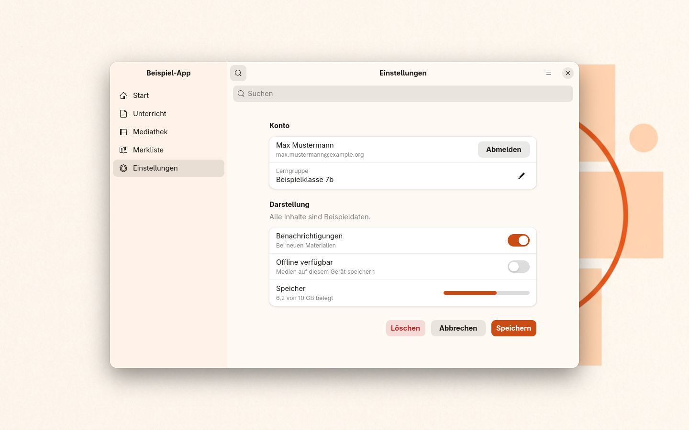
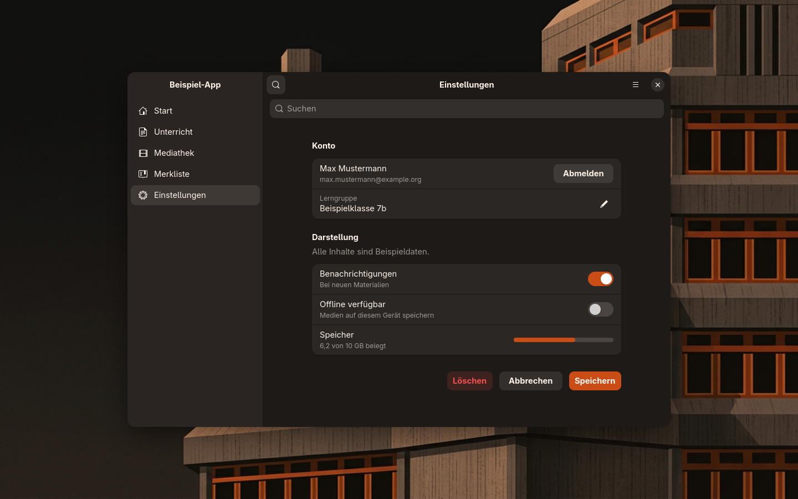
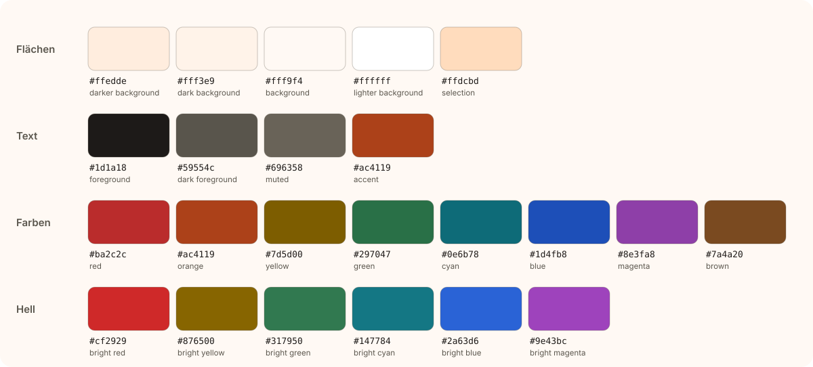
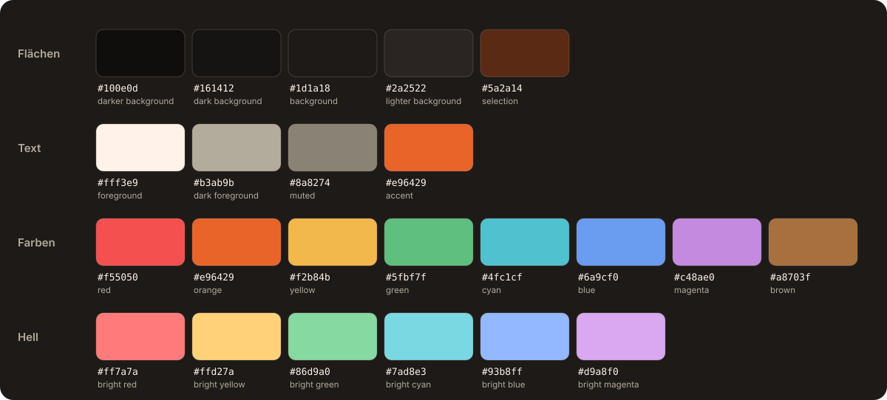
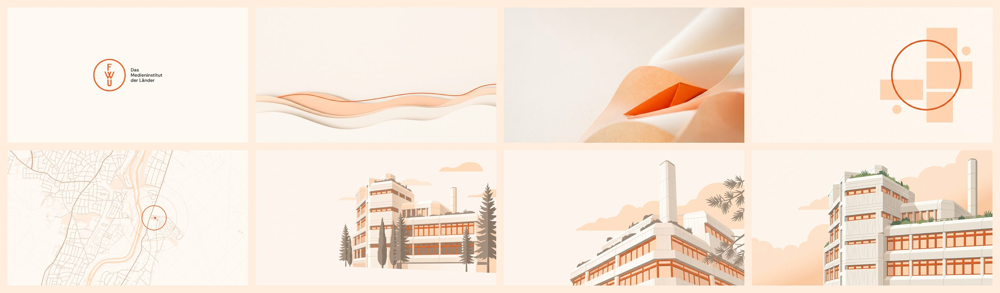
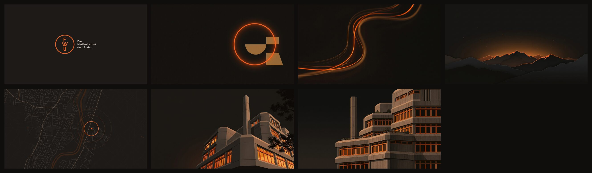

# FWU · Desktop-Theme

Das Theme von **FWU – Das Medieninstitut der Länder** für Linux-Desktops: für **GNOME** auf jeder Distribution und für **Omarchy**, jeweils hell wie fwu.de und dunkel in warmem Anthrazit. Ein Repo, keine Abhängigkeiten.





<sub>Beispielfenster mit erfundenen Daten.</sub>

## Installieren

### Ohne Paket (jede Distribution)

```sh
gh repo clone FWU-DE/fwu-desktop-theme
cd fwu-desktop-theme
./install.sh            # nur für den eigenen Benutzer, kein root nötig
fwu-theme apply         # GNOME: Theme einschalten
```

`sudo ./install.sh` installiert systemweit nach `/usr/local`. Entfernen mit `./install.sh --uninstall`.

### Als Paket

Fertige Pakete hängen an jedem [Release](https://github.com/FWU-DE/fwu-desktop-theme/releases):

| System | Befehl |
|---|---|
| Debian, Ubuntu | `sudo apt install ./fwu-desktop-theme_*.deb` |
| Fedora, openSUSE, RHEL | `sudo dnf install ./fwu-desktop-theme-*.rpm` |
| Arch, Omarchy | `sudo pacman -U fwu-desktop-theme-*.pkg.tar.zst` |
| Alpine, postmarketOS | `sudo apk add --allow-untrusted fwu-desktop-theme-*.apk` |

```sh
gh release download --repo FWU-DE/fwu-desktop-theme --pattern '*.deb'
```

## GNOME

```sh
fwu-theme apply          # folgt dem Hell-/Dunkel-Schalter von GNOME
fwu-theme apply dark     # und schaltet gleich auf dunkel
fwu-theme wallpaper list
fwu-theme wallpaper fassade
```

Für Leiste und Menüs braucht GNOME die Erweiterung **User Themes** – auf vielen Systemen schon da, sonst `gnome-shell-extensions` (Fedora: `gnome-shell-extension-user-theme`). Fehlt sie, sagt `fwu-theme apply` Bescheid; alles andere funktioniert auch ohne.

| Teil | Wie |
|---|---|
| Hintergrundbilder | in *Einstellungen → Darstellung* als »FWU · …«; Motive aus beiden Varianten wechseln mit dem Dunkelmodus |
| Programme (GTK 4 / libadwaita) | Fenster, Kopf- und Seitenleisten, Karten und Akzent über `~/.config/gtk-4.0/gtk.css`; wechseln selbst zwischen hell und dunkel |
| Programme (GTK 3) | über `~/.config/gtk-3.0/gtk.css` |
| Leiste, Menüs, Übersicht | Shell-Themes `FWU` und `FWU-Dark`: GNOMEs eigenes Stylesheet, nur die Farben überschrieben – bleibt bei GNOME-Updates intakt |
| Akzentfarbe | `orange` für Programme, die keine eigenen Farben laden |
| Symbole | `Yaru-red` bzw. `Yaru-red-dark`, falls installiert |

Ein kleiner Hintergrundprozess (`fwu-theme watch`, startet bei der Anmeldung) wechselt GTK-3-Farben, Shell-Theme und Symbole mit dem Dunkelmodus. `fwu-theme apply` ändert nur Einstellungen des eigenen Benutzers; in eine vorhandene `gtk.css` setzt es einen markierten Block an den Anfang und lässt den Rest stehen. `fwu-theme reset` nimmt alles zurück.

Flatpak-Apps lesen die Farben nur mit Freigabe: `fwu-theme apply --flatpak`.

## Omarchy

```sh
fwu-theme omarchy            # Themes fwu und fwu-dark verlinken
omarchy theme set fwu-dark
```

Oder gleich beim Installieren: `./install.sh --omarchy`. Wer die Themes früher mit `omarchy theme install` aus den alten Einzel-Repos geholt hat, ersetzt sie mit `fwu-theme omarchy --force`.

Die Omarchy-Themes bringen Palette, Leiste, Launcher, Menü, Benachrichtigungen, Sperrbildschirm (mit FWU-Logo) und die Symbole mit; Terminals, Editor und Browser färbt Omarchy daraus selbst.

## Farben

| Rolle | hell | dunkel |
|---|---|---|
| Hintergrund | `#fff9f4` Off-White | `#1d1a18` warmes Anthrazit |
| Text | `#1d1a18` | `#fff3e9` |
| Akzent für Text und Links | `#ac4119` | `#e96429` (Markenorange) |
| Akzent für Flächen mit weißer Schrift | `#ca4d15` | `#ca4d15` |

Das Markenorange `#e96429` stammt aus `--color-morange` auf fwu.de. Auf Off-White und unter weißer Schrift erreicht es nur 3,3 : 1; deshalb nutzen Texte im hellen Theme `#ac4119` und gefüllte Schaltflächen `#ca4d15` – das dunkelste Markenorange mit 4,5 : 1 für weiße Schrift. Auf dem dunklen Grund erreicht `#e96429` 5,3 : 1.

| hell | dunkel |
|---|---|
|  |  |

## Hintergrundbilder

Alle Bilder in 3840 × 2160.





| Motiv | hell | dunkel |
|---|:-:|:-:|
| FWU-Logo | ✓ | ✓ |
| Papierwellen | ✓ | |
| Papierfalte | ✓ | |
| Leuchtender Kreis | ✓ | ✓ |
| Karte des Standorts Grünwald | ✓ | ✓ |
| Gebäude | ✓ | ✓ |
| Untersicht | ✓ | |
| Fassade | ✓ | ✓ |
| Lichtspuren | | ✓ |
| Berge im Abendlicht | | ✓ |

## Aufbau

| Pfad | Inhalt |
|---|---|
| `themes/fwu`, `themes/fwu-dark` | die Omarchy-Themes – **Quelle** für Farben (`colors.toml`) und Bilder |
| `gnome/` | daraus erzeugt: GTK-Farben, Shell-Themes, Bilderliste |
| `bin/fwu-theme` | Befehl für GNOME und Omarchy (POSIX-sh, braucht nur `gsettings`) |
| `install.sh` | Installation ohne Paketmanager |
| `tools/build.py` | erzeugt `gnome/` neu – nach Änderungen an `themes/` |
| `tools/screenshots.py` | erzeugt die Bilder in `docs/` mit Beispieldaten |
| `tools/package.sh`, `nfpm.yaml` | Pakete bauen |

Nach Änderungen an Farben oder Bildern: `tools/build.py` (Python 3.11+, auf einem GNOME-Rechner auch für die Shell-Themes), dann `tools/screenshots.py`, beides committen.

Eine neue Version entsteht mit einem Tag: `git tag v1.1.0 && git push --tags`. GitHub Actions baut daraus `.deb`, `.rpm`, `.apk`, das Arch-Paket und ein Tarball und hängt sie an das Release.

## Quellen und Lizenzen

Kartendaten © [OpenStreetMap](https://www.openstreetmap.org/copyright)-Mitwirkende (ODbL). Name und Logo gehören FWU – Das Medieninstitut der Länder. Die Shell-Themes unter `gnome/shell/` sind aus dem Stylesheet von GNOME Shell abgeleitet und stehen wie dieses unter der GPL-2.0-or-later.
