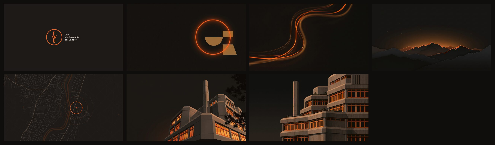
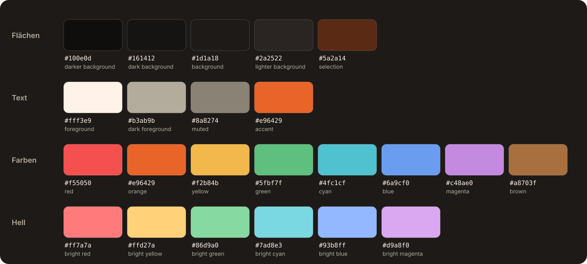

# FWU · Omarchy-Theme (dunkel)

Dunkles [Omarchy](https://omarchy.org)-Theme in den Farben von **FWU – Das Medieninstitut der Länder**. Warmes Anthrazit statt Off-White, das Markenorange bleibt unverändert der Akzent.



Die helle Variante wie auf fwu.de: [omarchy-fwu-theme](https://github.com/FWU-DE/omarchy-fwu-theme).

## Installieren

```sh
omarchy theme install https://github.com/FWU-DE/omarchy-fwu-dark-theme
omarchy theme set fwu-dark
```

Aktualisieren mit `omarchy theme update`.

## Farben



| Rolle | Wert | Herkunft |
|---|---|---|
| Hintergrund | `#1d1a18` | warmes Anthrazit |
| Markierung | `#5a2a14` | dunkles Orange |
| Akzent | `#e96429` | `--color-morange` auf fwu.de |
| Text | `#fff3e9` | warmes Off-White |

Auf dem dunklen Grund erreicht das Markenorange **5,3:1** und kann ohne Anpassung als Akzent und Textfarbe dienen.

## Hintergrundbilder

Alle Bilder in 3840 × 2160, auszuwählen über `Super + Ctrl + Space`.

| Nr. | Motiv |
|---|---|
| 0 | FWU-Logo auf Anthrazit |
| 1 | Leuchtender Kreis und Formen |
| 2 | Lichtspuren |
| 3 | Berge im Abendlicht |
| 4 | Karte des Standorts Grünwald |
| 5 | Gebäude bei Nacht |
| 6 | Fassade |

## Was das Theme mitbringt

| Datei | Inhalt |
|---|---|
| `colors.toml` | Palette, aus der Omarchy Terminals, Editor, Browser, Claude Code und Shell erzeugt |
| `shell.*.toml` | Leiste, Launcher, Menü, Benachrichtigungen und Sperrbildschirm |
| `icons.theme` | `Yaru-red-dark` |
| `unlock.png` | FWU-Logo für den Sperrbildschirm |
| `backgrounds/` | die sieben Hintergrundbilder |

## Quellen

Kartendaten © [OpenStreetMap](https://www.openstreetmap.org/copyright)-Mitwirkende (ODbL). Name und Logo gehören FWU – Das Medieninstitut der Länder.
