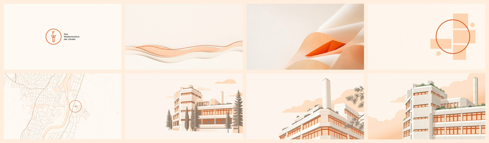
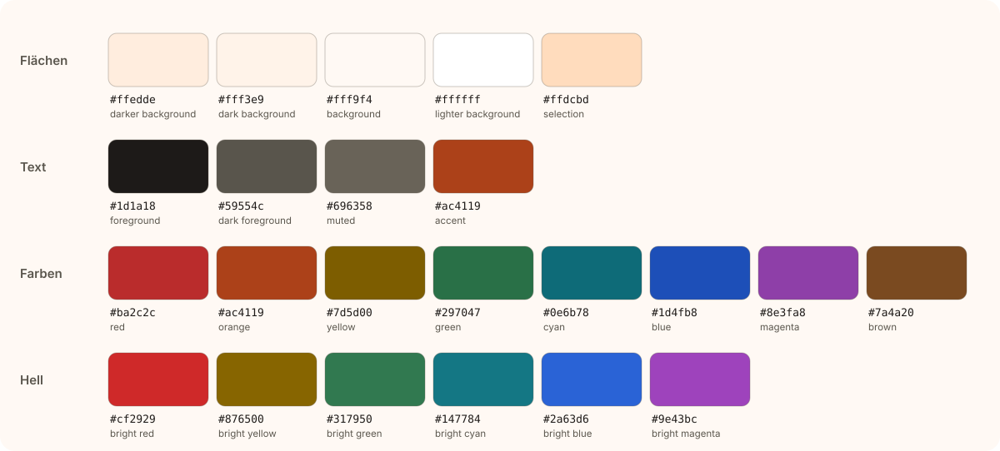

# FWU · Omarchy-Theme (hell)

Helles [Omarchy](https://omarchy.org)-Theme in den Farben von **FWU – Das Medieninstitut der Länder**. Off-White, warmes Orange und ruhige Papierflächen, abgenommen von den CSS-Variablen auf [fwu.de](https://fwu.de).



Die dunkle Variante: [omarchy-fwu-dark-theme](https://github.com/FWU-DE/omarchy-fwu-dark-theme).

## Installieren

```sh
omarchy theme install https://github.com/FWU-DE/omarchy-fwu-theme
omarchy theme set fwu
```

Aktualisieren mit `omarchy theme update`.

## Farben



| Rolle | Wert | Herkunft |
|---|---|---|
| Hintergrund | `#fff9f4` | `--color-offwhite` auf fwu.de |
| Markierung | `#ffdcbd` | `--color-warmorange` |
| Akzent | `#ac4119` | abgedunkeltes Markenorange |
| Text | `#1d1a18` | warmes Anthrazit |

Das Markenorange `#e96429` erreicht auf Off-White nur 3,2:1 und taugt dort nicht für Text. Akzente nutzen deshalb `#ac4119`. Alle Grundfarben halten mindestens **4,6:1 (WCAG AA)** auf jeder Fläche und auf der Markierung.

## Hintergrundbilder

Alle Bilder in 3840 × 2160, auszuwählen über `Super + Ctrl + Space`.

| Nr. | Motiv |
|---|---|
| 0 | FWU-Logo auf Off-White |
| 1 | Papierwellen |
| 2 | Papierfalte |
| 3 | Kreis und Flächen |
| 4 | Karte des Standorts Grünwald |
| 5 | Gebäude |
| 6 | Gebäude in Untersicht |
| 7 | Fassade |

## Was das Theme mitbringt

| Datei | Inhalt |
|---|---|
| `colors.toml` | Palette, aus der Omarchy Terminals, Editor, Browser und Shell erzeugt |
| `shell.*.toml` | Leiste, Launcher, Menü, Benachrichtigungen und Sperrbildschirm |
| `claude.json` | Claude-Code-Farben mit lesbaren Grautönen (mindestens 4,6:1) |
| `icons.theme` | `Yaru-red` |
| `unlock.png` | FWU-Logo für den Sperrbildschirm |
| `backgrounds/` | die acht Hintergrundbilder |

Der Sperrbildschirm bleibt in beiden Varianten dunkel, damit das helle Logo in `unlock.png` lesbar ist.

## Quellen

Kartendaten © [OpenStreetMap](https://www.openstreetmap.org/copyright)-Mitwirkende (ODbL). Name und Logo gehören FWU – Das Medieninstitut der Länder.
